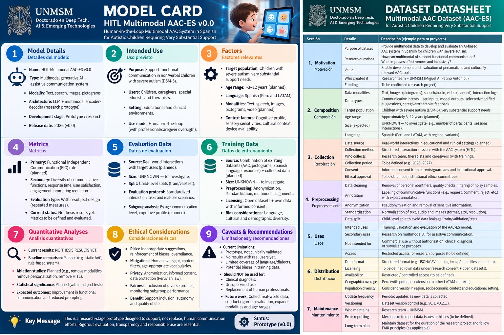

# Deliverable 07 — Model Card + Dataset Datasheet

**Course:** Research Methods and Scientific Integrity in AI and Advanced Technologies  
**Doctoral Program:** Deep Tech, Artificial Intelligence & Emerging Technologies — UNMSM  
**Student:** Miguel Ángel Patiño Antonioli  
**Instructor:** Dr. Loveleen Gaur  
**Semester:** 2026-II

## Deliverable
This folder contains the Session 7 deliverable: a **Model Card** for the doctoral research artifact and a **Datasheet** for the planned research dataset, following the documentation structures discussed in class (Mitchell et al., 2019; Gebru et al., 2021).

### Research artifact
**HITL Multimodal AAC-ES v0.0** — a research-stage human-in-the-loop, Spanish-language multimodal augmentative and alternative communication prototype intended to support independent functional communication in a bounded subgroup of autistic children requiring very substantial support.

## Evidence status
This is a **pre-implementation / pre-data-collection specification**. No participant data have been collected and no thesis performance or clinical-effectiveness results are claimed. Fields that remain unresolved are explicitly marked `UNKNOWN — to investigate`.

## Files
- `model_card.md` — 9 Model Card sections.
- `datasheet.md` — 7 Datasheet lifecycle sections.
- `documentation_scorecard.md` — course self-audit; target 8/8.
- `annex_iv_crosswalk.md` — educational EU AI Act Annex IV gap analysis.
- `REPRODUCIBILITY_REPORT.md` — status, evaluation boundary and integrity note.
- `Session7_HandsOn_Miguel_Patino.ipynb` — customized Session 7 notebook.
- `Notebook_HandsOn_Executed [PATIÑO, Miguel].ipynb` — executed notebook.
- `Deliverable_07_Model_Card_Datasheet_Miguel_Patino.pdf` — PDF version.

## Important interpretation
The Wisconsin Breast Cancer analyses inside the course notebook are **educational lab exercises only**. They illustrate fair baselines, seed variance, ablation, significance, compute matching and leakage. They are not results from the doctoral AAC study.

## Model Card Infographic

## Reproducibility target
The documentation package is intended to let a reviewer understand what will be built, what data are planned, how the artifact will be evaluated, which uses are out of scope, which risks are anticipated, and which items must be finalized before human-data collection.

